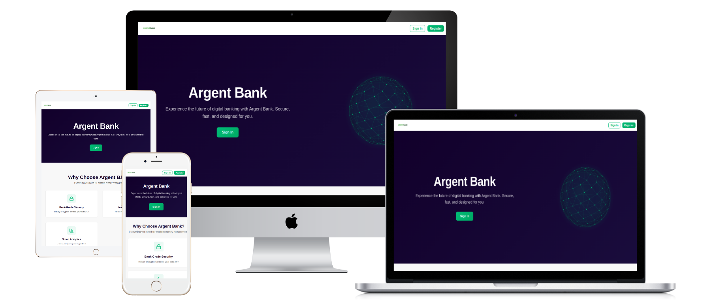

<h1 align="center">Argent Bank</h1>

<p align="center"><strong>Languages:</strong> <a href="README.md">English</a> | <a href="README.fr.md">Français</a></p>

<p align="center">
  <a href="https://steinshy.github.io/OC-ArgentBank/"><strong>Live demo →</strong></a>
</p>

<p align="center">
  
</p>

Banking dashboard SPA built for the OpenClassrooms front-end path: sign in, manage your profile, browse account transactions.

## Live demo

The demo runs without a backend: an in-browser mock API (`src/api/mockApi.ts`) answers the same endpoints as the Express server.

| Email              | Password      |
| ------------------ | ------------- |
| `tony@stark.com`   | `password123` |
| `steve@rogers.com` | `password456` |

Accounts you register and profile edits are kept in your browser's `localStorage`.

## Features

- Sign in, register and sign out, with optional "remember me"
- Protected profile, settings and transactions pages
- Profile name editing
- Account transactions with detail view and category/notes editing (local only)

## Tech stack

| Area     | Stack                                                       |
| -------- | ----------------------------------------------------------- |
| Frontend | React 19, TypeScript, Vite 8, Redux Toolkit, React Router 8 |
| Backend  | Express 5, MongoDB (Mongoose), JWT, Swagger UI              |
| Tooling  | pnpm workspace, ESLint, Stylelint, Prettier                 |

## Getting started

Requires Node.js 24 and pnpm (`corepack enable` picks the version pinned in `package.json`).

```bash
git clone https://github.com/Steinshy/OC-ArgentBank.git
cd OC-ArgentBank
pnpm install
```

### Frontend only (mock API)

```bash
VITE_USE_MOCK=true pnpm dev
```

### Full stack

Requires Podman with `podman compose` for the local MongoDB.

```bash
cp Backend/.env.example Backend/.env   # set JWT_SECRET
pnpm dev:all                           # MongoDB + API on :3001 + seeded users + frontend on :5173
podman compose down                    # stop MongoDB when done
```

API reference and Swagger UI: [Backend/README.md](./Backend/README.md).

## Configuration

| Variable            | Default                 | Purpose                                         |
| ------------------- | ----------------------- | ----------------------------------------------- |
| `VITE_API_BASE_URL` | `http://localhost:3001` | Backend URL                                     |
| `VITE_USE_MOCK`     | unset                   | `true` serves data from the in-browser mock API |
| `VITE_BASE_PATH`    | `/`                     | Base path when hosted in a subfolder            |

## Scripts

| Command        | Purpose                             |
| -------------- | ----------------------------------- |
| `pnpm dev`     | Vite dev server                     |
| `pnpm dev:all` | MongoDB + backend + seed + frontend |
| `pnpm build`   | Production build to `dist/`         |
| `pnpm preview` | Preview the production build        |
| `pnpm lint`    | ESLint + Stylelint                  |
| `pnpm fix`     | ESLint --fix + Prettier --write     |
| `pnpm check`   | tsc + lint + Prettier --check       |

## Deployment

Both targets build in mock mode, so no backend is deployed.

- **GitHub Pages:** `.github/workflows/deploy.yml` builds and publishes on every push to `main`.
- **Coolify:** the `Dockerfile` builds the app and serves it with nginx.

## Documentation

- [ARCHITECTURE.md](./ARCHITECTURE.md): architecture decisions
- [Backend/README.md](./Backend/README.md): API, environment and database setup
